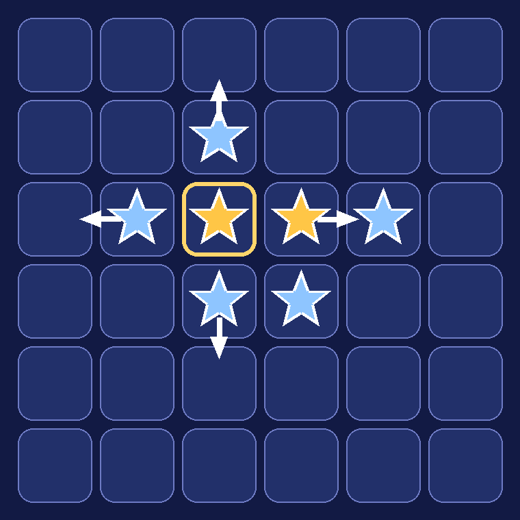
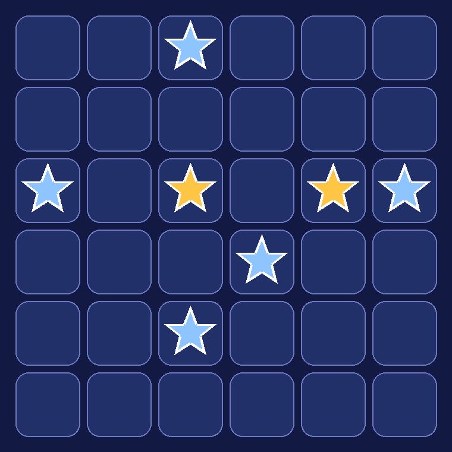
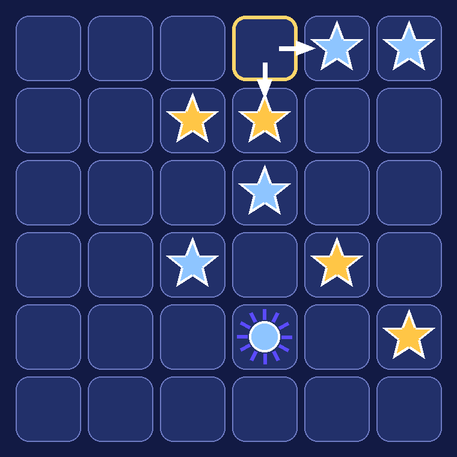
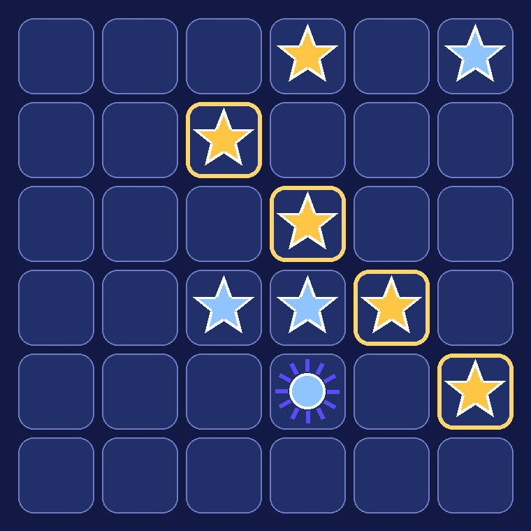

# Созвездие — правила

**2 игрока · 15–25 минут · 8+ · без случайности**

## Цель
Первым выстроить **4 свои фишки в ряд** (горизонталь, вертикаль или диагональ) **или набрать 5 трофеев** — столкнуть с поля 5 звёзд соперника.

## Состав
Поле 6×6. У каждого игрока 10 звёзд и 1 Солнце. Первыми ходят золотые. Лазурные за второй ход сразу получают **1 трофей** (фора).

## Ход
1. Поставь одну фишку из запаса на любую пустую клетку. Солнце нельзя ставить самым первым ходом партии.
2. **Толчок.** Новая фишка отталкивает соседей вверх, вниз, влево и вправо (диагонали не трогает). В каждом направлении вся сплошная цепочка фишек — и своих, и чужих — сдвигается на 1 клетку от новой фишки.
3. **Край.** Если цепочку вытолкнули за край, крайняя фишка падает: чужая звезда становится твоим трофеем, своя возвращается в твой запас.
4. **Солнце** никогда не сдвигается: цепочка, в которой есть Солнце, стоит на месте. Само Солнце толкает и считается в ряду.
5. Если в запасе нет звёзд, ход — переставить свою звезду с поля на другую пустую клетку (она тоже толкает).

 

## Конец партии
* Победа проверяется сразу после хода. Если ряд получился у обоих — побеждает ходивший. Если ты сам подтолкнул соперника в ряд, а у тебя ряда нет — побеждает соперник.
* 5 трофеев — победа.
* 50 ходов каждого без победы — ничья.

## Пример
Золотые ставят звезду на г1: вправо лазурная вылетает за край (трофей), вниз цепочка «золотая + лазурная» сдвигается, и золотая встаёт в диагональ в2–г3–д4–е5. Победа.

 

## Советы
* Прямой ряд нельзя продлить вплотную — новая фишка оттолкнёт своих соседей. Собирайте ряды по диагонали, ставьте фишку через клетку или вталкивайте свою цепочку на место.
* Не держите звёзды у края без защиты — это трофеи для соперника.
* Солнце, поставленное в линию, защищает её от толчков.
